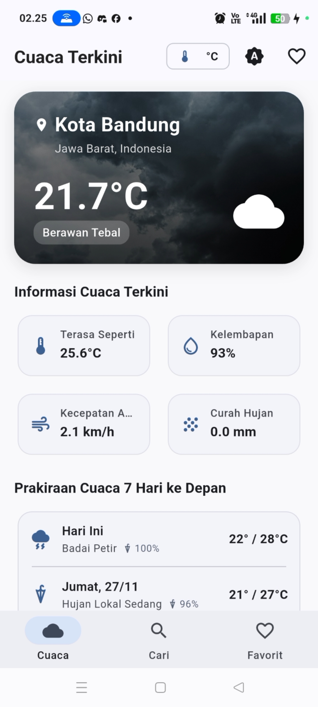
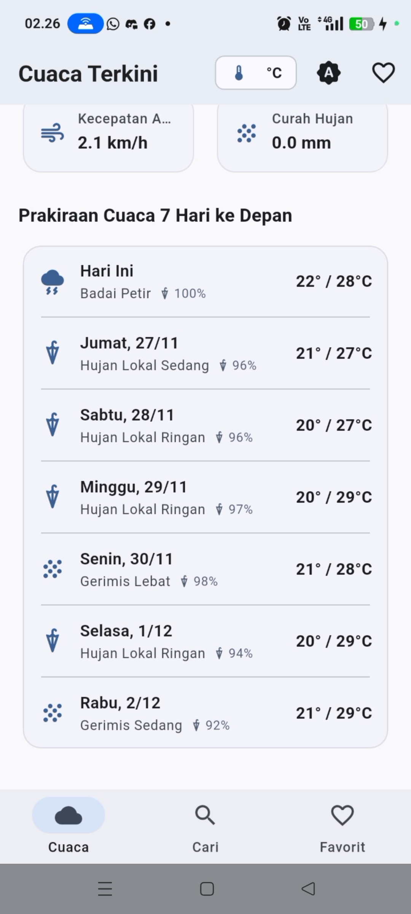
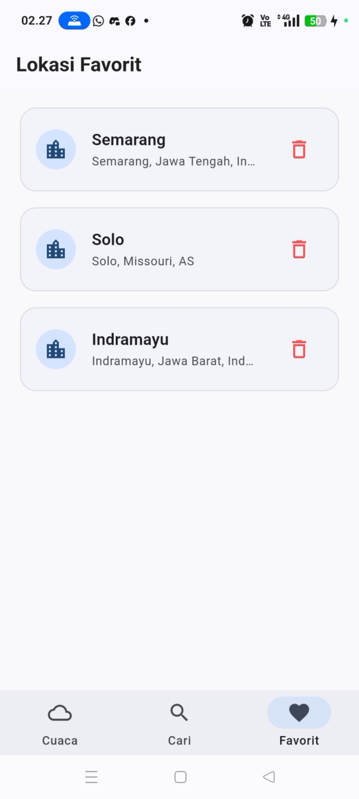

# Responsi Pemrograman Mobile - Aplikasi Cuaca Open-Meteo

Aplikasi cuaca berbasis Flutter (Dart) yang menerapkan arsitektur **Model-View-ViewModel (MVVM)**, state management **Provider (ChangeNotifier)**, local storage **SharedPreferences**, dan integrasi dengan **Open-Meteo REST API** (Geocoding API dan Forecast API).

---

## Identitas Pengembang

- **Nama** : Wati Rustati
- **NIM** : H1D024007
- **Shift Awal** : B
- **Shift Akhir** : F
- **Link Video Penjelasan** : [Tonton video penjelasan kode](https://drive.google.com/file/d/1__xiFA4OVBAkN-IfHW0EbhrYEnVRDlWn/view?usp=sharing)

---

## 1. Deskripsi Singkat Aplikasi

Aplikasi ini memungkinkan pengguna memantau cuaca terkini dan prakiraan harian (7 hari ke depan) berdasarkan kota di seluruh dunia.

- **Cuaca Terkini**: menampilkan nama kota, foto latar yang menyesuaikan kondisi cuaca (cerah, berawan, gerimis, hujan, badai), suhu saat ini, kondisi cuaca WMO (teks dan ikon), suhu yang dirasakan, kelembapan udara, kecepatan angin, curah hujan, dan kemungkinan hujan.
- **Pencarian Kota**: memakai Open-Meteo Geocoding API untuk mencari koordinat kota secara dinamis, tanpa data statis.
- **Local Storage**: menyimpan lokasi favorit, riwayat pencarian, dan lokasi terakhir dengan `shared_preferences`, sehingga data tetap ada saat aplikasi ditutup dan dibuka kembali.
- **State Management Reaktif**: `Provider` (`ChangeNotifier`) mengelola kondisi tampilan: *Loading*, *Loaded*, *Empty*, dan *Error* (dengan tombol *Coba Lagi*).
- **Pengaturan Satuan Suhu dan Tema**: chip satuan suhu (°C / °F) dikirim ke parameter API `temperature_unit`, dan tombol tema (Sistem / Mode Gelap) tersedia di header aplikasi.

---

## 2. Teknologi dan Library

| Komponen | Keterangan |
|---|---|
| Bahasa / Framework | Dart dan Flutter (Material Design) |
| State management | `provider` |
| HTTP request | `http` |
| Local storage | `shared_preferences` |
| Sumber data | Open-Meteo (tidak memerlukan API key) |

---

## 3. Struktur Folder Proyek (MVVM)

```text
responsi_cuaca/
├── lib/
│   ├── main.dart                       # Entry point, inisialisasi storage dan MultiProvider
│   ├── models/
│   │   ├── location.dart               # Model lokasi (Geocoding API dan local storage)
│   │   └── weather.dart                # Model cuaca terkini dan prakiraan harian
│   ├── services/
│   │   ├── weather_service.dart        # HTTP GET ke Open-Meteo
│   │   └── storage_service.dart        # Membaca dan menyimpan SharedPreferences
│   ├── viewmodels/
│   │   ├── weather_viewmodel.dart      # State layar cuaca utama
│   │   ├── search_viewmodel.dart       # State pencarian kota (Geocoding API)
│   │   ├── favorites_viewmodel.dart    # State data favorit
│   │   └── settings_viewmodel.dart     # State satuan suhu dan tema
│   ├── views/
│   │   ├── main_navigation_screen.dart # NavigationBar utama (3 tab)
│   │   ├── weather_screen.dart         # Cuaca terkini dan prakiraan 7 hari
│   │   ├── search_screen.dart          # Input pencarian, hasil, dan riwayat
│   │   └── favorites_screen.dart       # Daftar lokasi favorit
│   ├── utils/
│   │   └── weather_code.dart           # Kode WMO ke teks Indonesia, ikon, dan foto latar
│   └── theme/
│       └── app_theme.dart              # ThemeData terpusat (Light dan Dark)
├── ssan/                               # Screenshot aplikasi
├── pubspec.yaml                        # Dependensi proyek
└── README.md                           # Dokumentasi
```

---

## 4. Implementasi API (Open-Meteo)

Aplikasi memakai dua endpoint resmi Open-Meteo, dengan metode **HTTP GET**.

> **Data tidak statis.** Seluruh informasi cuaca diambil dari Open-Meteo API. Saat aplikasi pertama kali dibuka dan belum ada data di local storage, lokasi default "Semarang" tetap melakukan request ke API memakai koordinatnya (lat: -6.9932, lon: 110.4203), bukan data cuaca bawaan.

### a. Geocoding API (Pencarian Lokasi)

- **Endpoint**: `https://geocoding-api.open-meteo.com/v1/search`
- **Parameter**:
    - `name`: nama kota yang dicari
    - `count`: jumlah hasil maksimum (`10`)
    - `language`: bahasa nama kota (`id`)
- **Contoh URL**: https://youtu.be/xPVLgS0LZCc?si=G6ub5VTHbM_BdJqB

### b. Weather Forecast API (Prakiraan Cuaca)

- **Endpoint**: `https://api.open-meteo.com/v1/forecast`
- **Parameter**:
    - `latitude` dan `longitude`: koordinat kota
    - `current`: `temperature_2m,relative_humidity_2m,apparent_temperature,precipitation,weather_code,wind_speed_10m`
    - `daily`: `weather_code,temperature_2m_max,temperature_2m_min,precipitation_probability_max`
    - `timezone`: `auto`
    - `temperature_unit`: `celsius` atau `fahrenheit` (sesuai pilihan pengguna)

### c. Pemetaan Field API ke Tampilan

| No | Data Cuaca | Field API Open-Meteo | Komponen UI |
|---|---|---|---|
| 1 | Suhu saat ini | `current.temperature_2m` | Kartu utama cuaca terkini |
| 2 | Kelembapan | `current.relative_humidity_2m` | Kartu detail kelembapan (%) |
| 3 | Suhu yang dirasakan | `current.apparent_temperature` | Kartu detail "Terasa Seperti" |
| 4 | Curah hujan | `current.precipitation` | Kartu detail curah hujan (mm) |
| 5 | Kode kondisi cuaca | `current.weather_code` | Ikon, foto latar, dan teks cuaca WMO |
| 6 | Kecepatan angin | `current.wind_speed_10m` | Kartu detail kecepatan angin (km/h) |
| 7 | Suhu maksimum harian | `daily.temperature_2m_max` | Daftar prakiraan 7 hari |
| 8 | Suhu minimum harian | `daily.temperature_2m_min` | Daftar prakiraan 7 hari |
| 9 | Peluang hujan maksimum | `daily.precipitation_probability_max` | Daftar prakiraan 7 hari (%) |

---

## 5. Penerapan Arsitektur MVVM

Tanggung jawab dipisah menjadi empat lapisan:

1. **Model** (`lib/models/`)
    - `LocationModel` dan `WeatherModel` mengubah JSON dari respons API menjadi objek Dart yang null-safe.
2. **View** (`lib/views/`)
    - Tidak memanggil API atau `SharedPreferences` secara langsung.
    - Hanya membaca properti ViewModel dan memanggil method ViewModel saat pengguna berinteraksi.
    - Menangani tiga kondisi pada screen yang memakai API: **Loading**, **Data Kosong**, dan **Error** (dengan tombol *Coba Lagi*).
3. **ViewModel** (`lib/viewmodels/`)
    - Turunan `ChangeNotifier` dari package Provider.
    - Menyimpan state (status loading, pesan error, data) dan menghubungkan View dengan `WeatherService` serta `StorageService`.
    - Memberi tahu View lewat `notifyListeners()`.
4. **Service** (`lib/services/`)
    - `WeatherService`: HTTP GET ke API dan penanganan kegagalan koneksi.
    - `StorageService`: penyimpanan dan pemuatan data lokal dengan `SharedPreferences`.

**Alur data:** `View` -> `ViewModel` -> `Service` -> API -> `Model` -> `ViewModel` -> `View`.

---

## 6. Cara Menjalankan Aplikasi

1. Pastikan Flutter SDK (stable) dan Android Studio sudah terpasang.
2. Sambungkan HP Android (aktifkan USB Debugging) atau jalankan emulator. Perangkat harus terhubung ke internet.
3. Buka terminal di folder proyek, lalu jalankan:

```bash
flutter pub get
flutter run
```

---

## 7. Tangkapan Layar Aplikasi (Screenshots)

### Weather Screen (Tab Cuaca)

| Cuaca Terkini | Prakiraan 7 Hari |
|---|---|
|  |  |

### Search Screen (Tab Cari)

| Input Pencarian | Hasil Pencarian |
|---|---|
|  |  |

### Favorites Screen (Tab Favorit)

| Daftar Favorit |
|---|
|  |

---

## 8. Pengujian Mandiri

- **Pencarian kota**: ketik "Bandung" di tab Cari, pilih hasilnya, lalu periksa apakah cuaca berpindah ke Bandung.
- **Favorit**: tekan tombol hati pada layar cuaca atau hasil pencarian, lalu buka tab Favorit. Tutup dan buka aplikasi lagi; favorit dan lokasi terakhir tetap tersimpan.
- **Penanganan error**: matikan WiFi atau data seluler, lalu tekan tombol "Coba Lagi" untuk melihat tampilan error.
- **Pencarian kosong**: ketik teks acak seperti "zzzxqw123" untuk melihat tampilan data kosong.